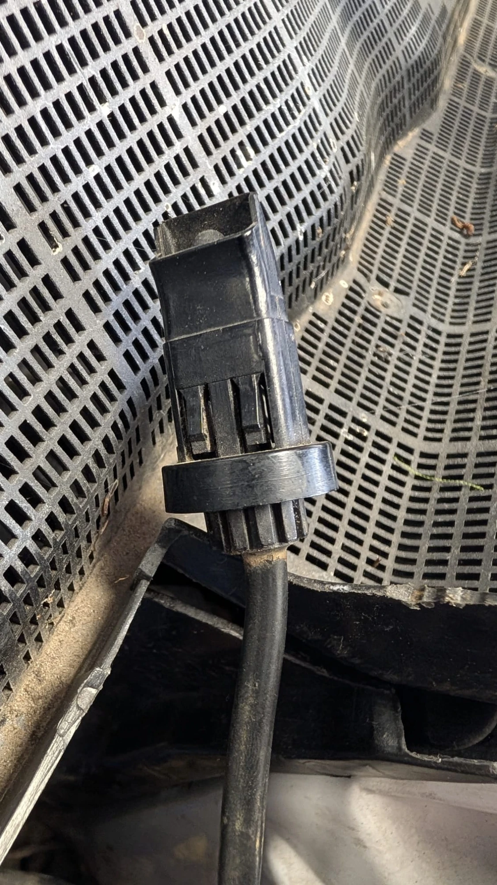

# 2026-10-11 — Battery frame replacement

**Mileage:** 
**System:** body
**Status:** open

## Symptom

With the battery removed, the battery frame (the tray the battery sits in) is badly corroded. It
can't be repaired and has to be replaced (owner, 2026-10-11).

## Parts

From EPC catalog 452, group 62.105 "Front panel attachment parts, battery frame". The catalog
diagram is in the private parts catalog (available on request).

### To order

| Pos | Part | Number | Qty | Size | Needed? |
|---|---|---|---|---|---|
| 35 | Frame, battery (62–92 Ah) | `A 201 626 04 45` | 1 | — | **Yes** |
| 41 | Nut, battery frame front | `N 000 934 00 6007` | 1 | M6 hex nut, DIN 934 (see note 1) | Optional, cheap |
| 44 | Washer, battery frame front | `A 201 990 06 40` | 1 | **Unknown**, measure the old one (see note 2) | Optional |
| 50 | Nut, battery frame to firewall | `N 000 934 00 6007` | 2 | M6 hex nut, DIN 934 (see note 1) | Optional, cheap |
| 53 | Washer, battery frame to firewall | `N 009 021 00 6208` (replaces `N 009 021 00 6205`) | 2 | Large washer DIN 9021 for M6: 6.4 mm hole, 18 mm outside, 1.6 mm thick (see note 1) | Optional, cheap |
| 56 | Rubber ring, battery frame to firewall | `A 201 987 02 41` (replaces `A 115 997 10 40`) | 2 | **Unknown**, measure the old one (see note 2) | Optional, cheap |

So the full order is 1 frame, 3 nuts, 1 front washer, 2 large washers and 2 rubber rings. Only the
frame is required; replace the small parts if the old ones are rusted or hard.

### Not needed

| Pos | Part | Number | Why |
|---|---|---|---|
| 38 | Rail, battery frame front (the battery hold-down) | `A 124 626 00 42` | Still in good shape, reused (owner) |
| 47 | Bracket, battery frame lateral | `A 201 626 00 14` | Not on the car. In the EPC diagram it's a small clip on the frame edge, not a load-bearing part. Add it only if something in that corner is left loose |

### Size notes

1. **N-numbers are DIN standard parts.** `N 000 934 …` is a DIN 934 hex nut and `N 009 021 …` is a
   DIN 9021 large washer. The `006` that follows is the thread size, M6: an aftermarket listing
   cross-references `N000934 006012` to an M6 nut
   ([pkwteile.de](https://www.pkwteile.de/dt/7344871), store listing, not archived). The same nut
   number holds the ignition coil and other small brackets in this car's EPC, which fits M6.
   Washer dimensions are the DIN 9021 standard values for M6. **Confidence: medium-high**, from
   the numbering scheme, not checked on the car. Confirm by test-fitting a nut on the old studs.
   A DIN 934 M6 nut takes a 10 mm wrench.
2. **No published size** for `A 201 990 06 40` or `A 201 987 02 41`. Measure the old parts when
   they come off (hole, outside diameter, thickness). The same rubber ring is used elsewhere in the
   EPC: a control unit bracket to the firewall (54.075) and the rear doors (80.045). It's also sold
   as the rubber disc under the trunk star on the W107 500SL
   ([Niemöller](https://www.niemoeller.de/de/w107/w107046-m117964-bj-ab-09-1985/B046/753002/c75036-gummischeibe-fuer-mercedes-stern),
   store listing, not archived).

## Fix

To do. Checklist:

- [ ] Order the frame and small parts (search by number without spaces, e.g. `A2016260445`; see
      [parts suppliers](../general-reference/parts-suppliers.md))
- [ ] Measure the old front washer and rubber rings, fill in the sizes above
- [ ] Remove the old frame: front nut and 2 nuts to the firewall
- [ ] Clean the body metal under the frame and the firewall: neutralize acid with baking soda and
      water, rinse, dry, rust converter, primer, paint
- [ ] Check the battery cable ends and the negative cable's ground point for acid damage
- [ ] Fit the new frame with new rubber rings, washers and nuts; refit the rail
- [ ] While the battery is out: look for R16 behind the plastic cover on the firewall (see below)

## Cost

Parts / labor: 

## Notes

### Found near the battery: sealed 2-wire part (unidentified)

A sealed black part hangs loose next to the battery, in front of the cowl air intake screen. One
round cable with 2 wires goes into it. Nothing can be unplugged from it. It has two spring latches
on the sides and a round collar, so it's made to snap into a rectangular hole and has probably
popped out of its mount. Where the wires go isn't known yet; the harness is taped shut (owner,
2026-10-11).

Not identified. Two ideas, neither confirmed:

- ~~**R16/1 ignition reference resistor**~~: ruled out. R16/1 was found below the air filter on
  2026-10-11 (`24 81`, 750 Ω). See [R16 note](../ignition/r16-reference-resistor.md).
- **An air temperature sensor** for the climate control, since it sits at the fresh-air intake next
  to the blower, and the blower was out recently.

Correction (2026-10-11): an earlier version said the owner measured OL at EZL contact 3. No such
measurement was taken; withdrawn.

To tell them apart: find the end of its cable, measure across the two wires, and warm the part by
hand. A reading that changes smoothly means a temperature sensor; a steady 220, 470, 750, 1300 or
2400 Ω means R16/1.
